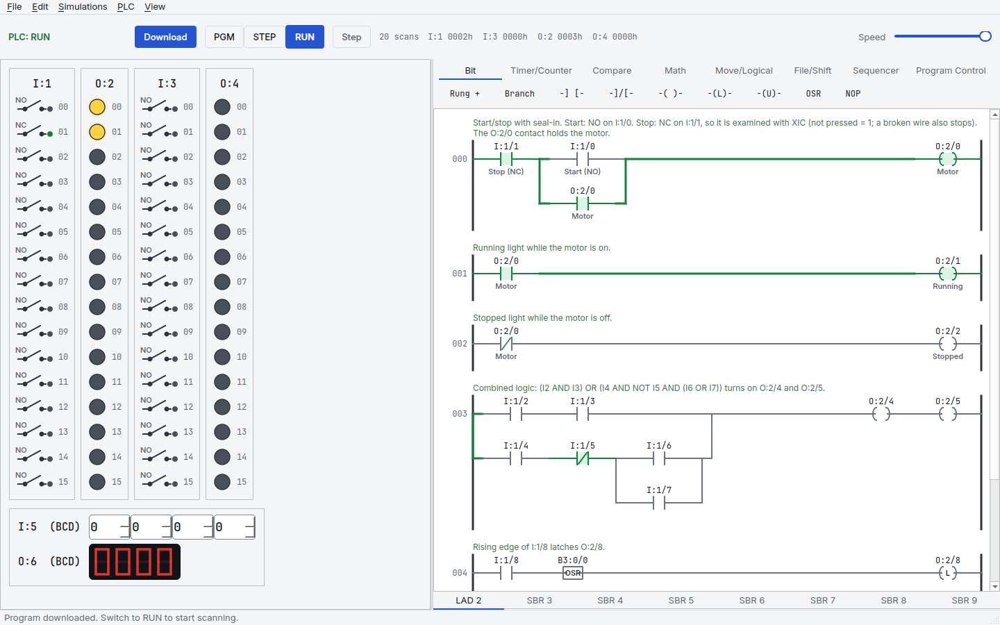
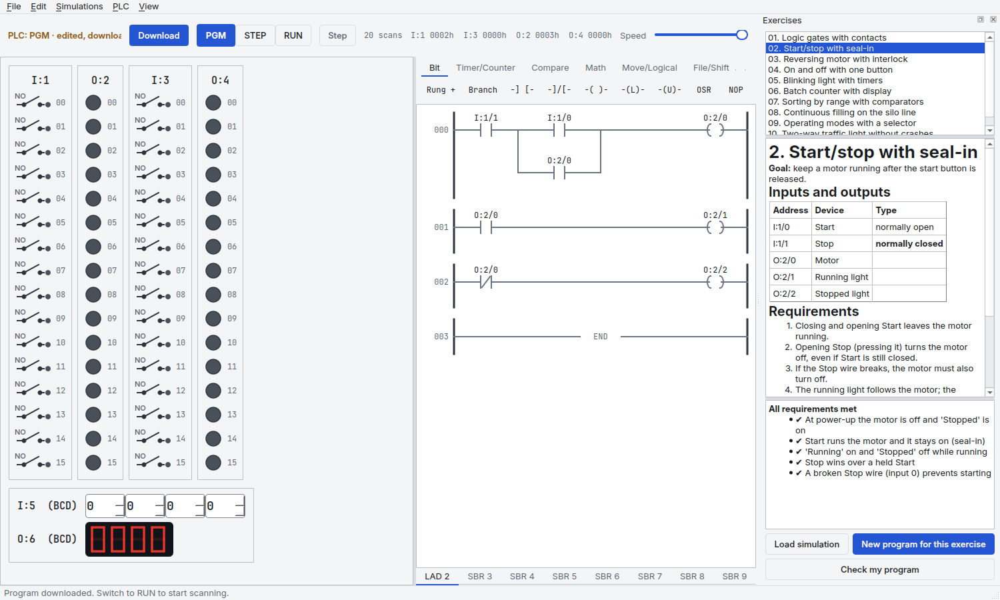
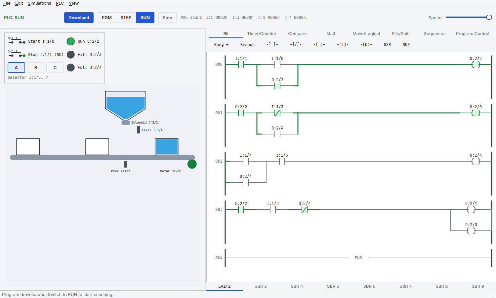
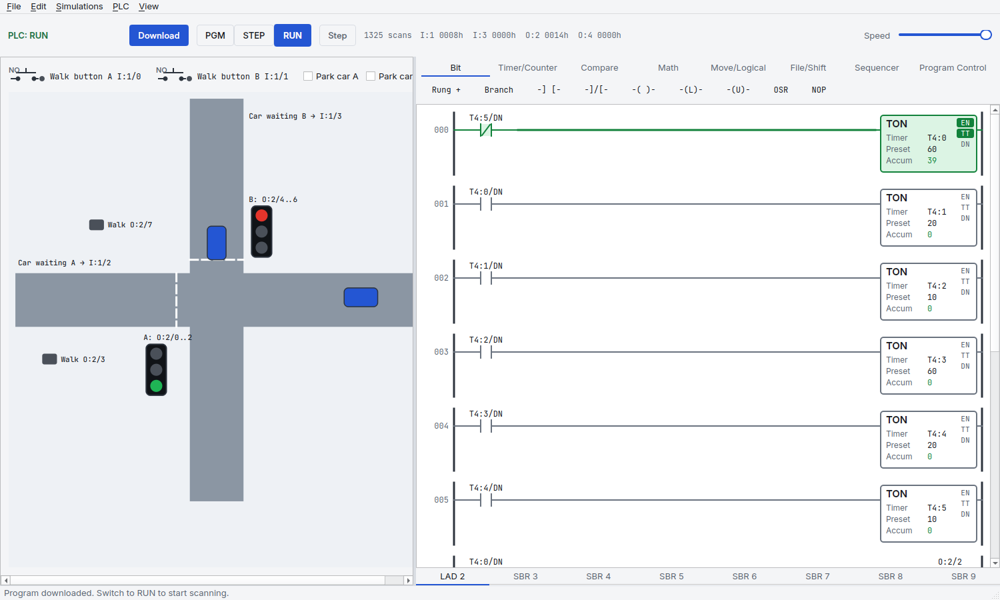
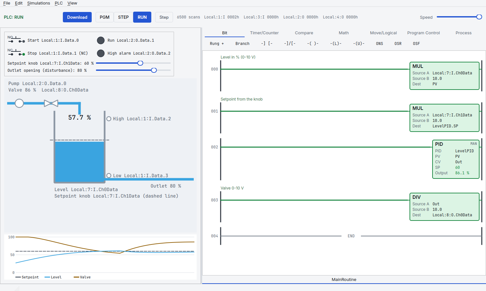
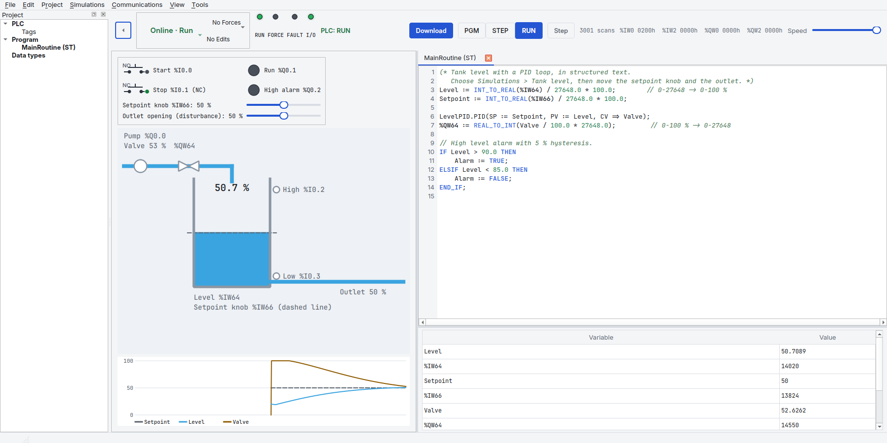

<p align="center"></p>

<h1 align="center">PLCYard</h1>

<p align="center">A free, open-source PLC trainer. Write ladder logic, run it on simulated machines,
and find out which requirement your program misses, without a teacher.</p>



## Why

Learning PLCs on your own is hard for two reasons: you need a PLC to practise on, and nobody tells
you whether your program is right until something on a real machine goes wrong. PLCYard gives you
both: a simulated SLC 500-style controller with machines to drive, and exercises that check your
program requirement by requirement.

It runs natively on Linux, macOS and Windows, stays sharp on high-resolution screens, and needs
no licence key.

## How it works

1. **Write** a program in the ladder editor: click an instruction, type its address (`I:1/0`,
   `T4:0`, `N7:5`), or drag it where you want.
2. **Run** it: Download, switch to RUN, and flip the switches. Energized paths turn green, timers
   and counters count live, the data table shows every value.
3. **Check** it: open an exercise and press *Check my program*. Each requirement shows ✔ or ✘ with
   the reason.



## Features

- **Check my program**: 13 exercises, from logic gates to tuning a PID level loop, each
  with automatic checks of every written requirement. Runs faster than real time.
- **Simulations**: I/O panel (16 inputs, 16 outputs per card, thumbwheels and a 7-segment BCD
  display), a filling line (silo), a road crossing (traffic lights) and an analog **tank level**
  process with a live trend of setpoint, level and valve.
- **PID and analog I/O**: SLC 500 `PID` (control block in an N file), Logix `PID` (Studio 5000
  operands) and S7 `PID_Compact` blocks, analog channels in each
  controller's own units (SLC counts, Logix volts, S7 0-27648) and scaling instructions.
- **Three controller styles**, chosen with File → New for controller:
  - **SLC 500**: data table addresses (`I:1/0`, `T4:0`, `N7:5`), 45 instructions including
    sequencers, bit shift and subroutines.
  - **Logix (Studio 5000 style)**: named tags (`Motor`, `Delay.DN`, `Local:1:I.Data.0`), timers in
    milliseconds, DINT math, SCP scaling.
  - **S7-1200/1500 (TIA Portal style)**: `%I0.0`, `%Q0.0`, `%MW10` and symbolic tags, IEC timers
    and counters (TON, TOF, TP, CTU, CTD) with instances, edge contacts, NORM_X/SCALE_X.
- **Laid out like the real software**: a Controller Organizer (Studio 5000) or Project tree (TIA
  Portal) on the left, each routine or block in its own tab, several open at once.
- **Several routines per program, in any language**: a ladder main routine calling an ST routine
  with `JSR` (Logix), functions and function blocks with their interface and instance data blocks
  (S7, `CALL` box or `"Block"(…)` in SCL).
- **User data types and arrays**: Logix UDTs and S7 PLC data types, `Recipe[Step].FillTime`.
- **Tag list** for Logix and S7: declare tags, open structures and arrays, watch and change values
  while running, **force** I/O points (also from the ladder and on SLC 500).
- **Examples** for every controller: traffic lights, silo filling line, motor starters as FB
  instances, recipes in a UDT array, PID tank loops.
- **Structured text** (ST / SCL) for Logix and S7, next to ladder: IF, CASE, FOR, WHILE, REPEAT,
  math and conversion functions, timer, counter and PID blocks called on their instance
  (`"Delay".TON(IN := Start, PT := T#2s)`). Syntax colours, line numbers, errors as you type and a
  watch list with live values.
- **Real scan behaviour**: prescan on entering RUN, first-pass bit S:1/15, outputs off in PGM,
  rung-order effects, major faults with codes.
- **Mistakes caught before you run**: wrong address types, addresses outside the data table,
  unset operands, all with a suggestion.
- **Switch types** from your symbols: write "Stop (NC)" or "Jog (PB)" and the switch is wired that
  way.
- **Projects (.plcy)**: readable JSON with the controller, programs, symbols and tables.
- **.rsl files**: open and save the plain-text ladder format used by SLC 500 trainers;
  unchanged programs save byte for byte.
- Light and dark themes, keyboard shortcuts for everything, undo/redo.

| | |
| --- | --- |
|  |  |
|  |  |

## Install

Python 3.11 or newer.

```bash
git clone https://github.com/juliordzcer/plcyard.git
cd plcyard
python3 -m venv .venv
.venv/bin/pip install -e .
.venv/bin/plcyard                      # or: .venv/bin/python -m plcyard
```

On Windows use `.venv\Scripts\pip` and `.venv\Scripts\plcyard`.

Open a sample from **File → Open example**, or press **Ctrl+E** for the exercises.

## Keyboard

| key | does |
| --- | --- |
| Ctrl+D / Ctrl+R / Ctrl+P | download / RUN / program mode |
| F10 | single scan (STEP mode) |
| Insert, Del, F2 | new rung, delete, edit operands |
| Ctrl+T / Ctrl+E | data table / exercises |

## Roadmap

- More simulations (door, elevator, batch mixing, bottle line) and exercises.
- Function block diagram (FBD), next to ladder and structured text.
- A wiki. Full list in [TODO.md](TODO.md).
- More UI languages.

Contributions are welcome: open an issue first for anything large.

## Develop

```bash
.venv/bin/pip install pytest pytest-qt
.venv/bin/python -m pytest              # 216 tests, about 2 minutes
```

Every fixed bug and design decision is in [DEVLOG.md](DEVLOG.md).

## Licence

GPL-3.0-or-later, see [LICENSE](LICENSE). Fonts: Inter and JetBrains Mono, SIL Open Font
Licence (`plcyard/ui/assets/fonts`).

PLCYard is an independent project, not affiliated with or endorsed by Rockwell Automation,
Siemens or any PLC vendor. Product names are used only to describe compatibility.
