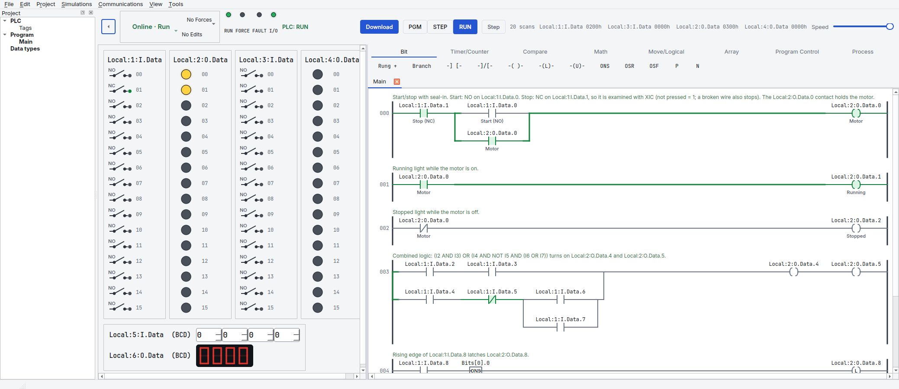
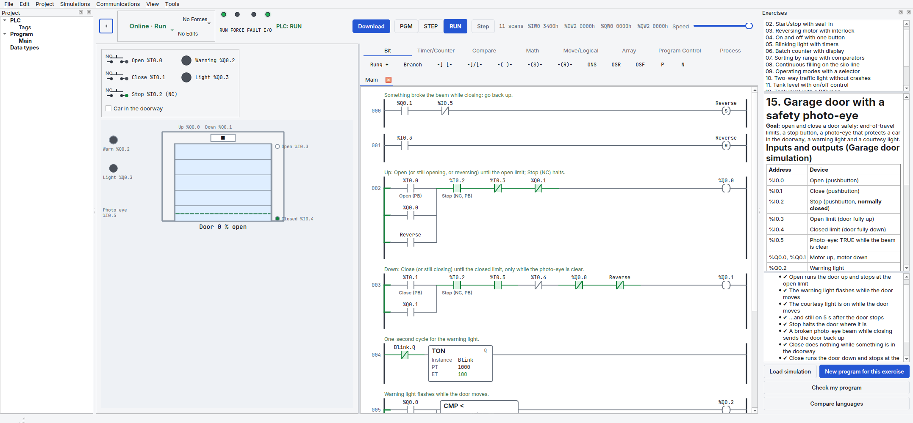
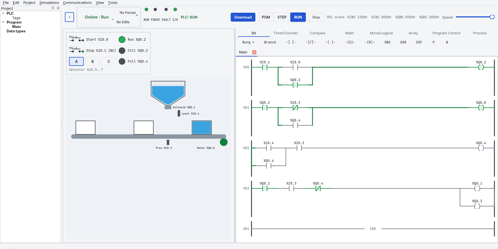
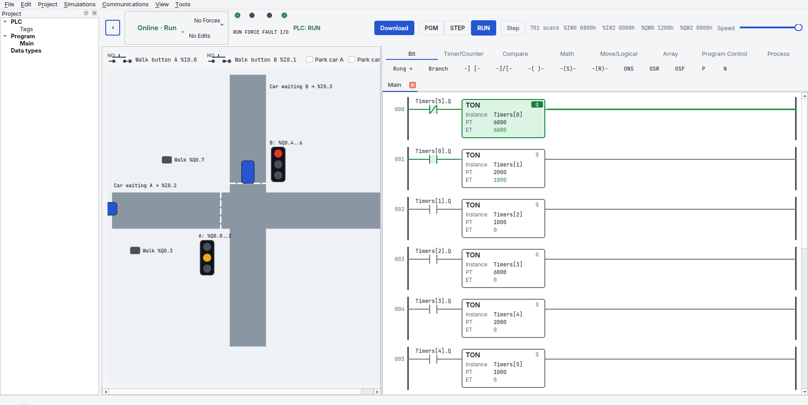
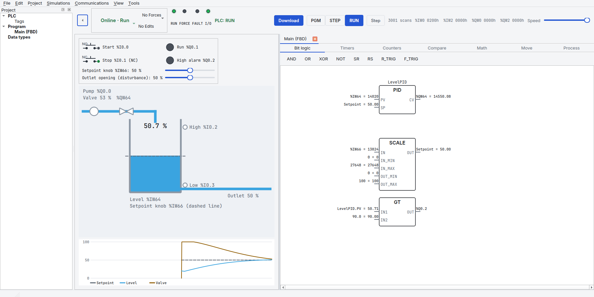
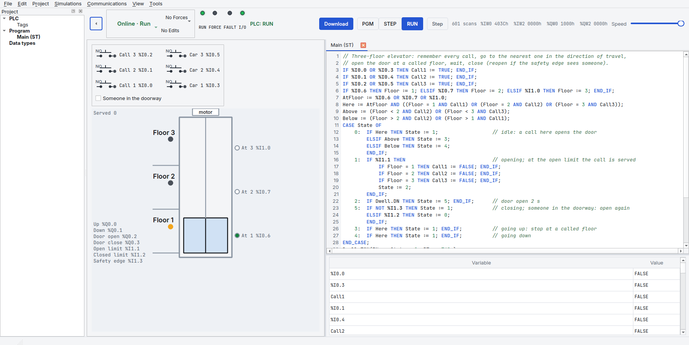
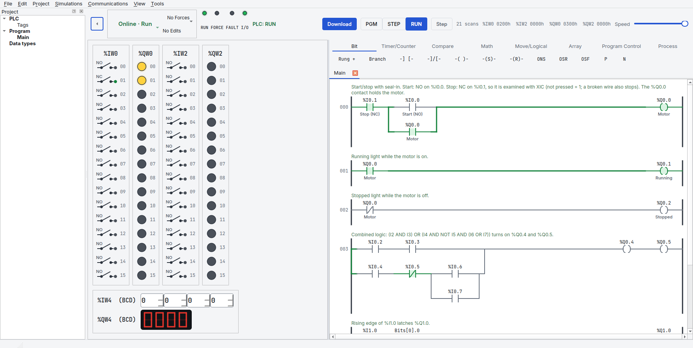

# Download

PLCYard is free and open source (GPL-3.0-or-later). It runs on Linux, macOS and Windows with
Python 3.11 or newer.



## Install

**Linux and macOS**

```bash
git clone https://github.com/juliordzcer/plcyard.git
cd plcyard
python3 -m venv .venv
.venv/bin/pip install -e .
.venv/bin/plcyard
```

**Windows** (PowerShell, with [Python](https://www.python.org/downloads/) and
[Git](https://git-scm.com/download/win) installed)

```powershell
git clone https://github.com/juliordzcer/plcyard.git
cd plcyard
py -m venv .venv
.venv\Scripts\pip install -e .
.venv\Scripts\plcyard
```

No Git? Download the source as a [zip](https://github.com/juliordzcer/plcyard/archive/refs/heads/main.zip),
unzip it and run the same commands from the `plcyard-main` folder.

## Update

From the `plcyard` folder: `git pull`, then start it again.

## Screenshots

| | |
| --- | --- |
|  |  |
|  |  |
|  |  |

Then read [Getting started](getting-started.md).
