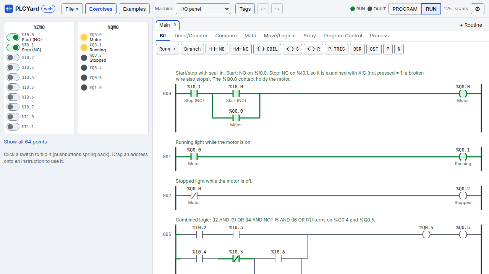
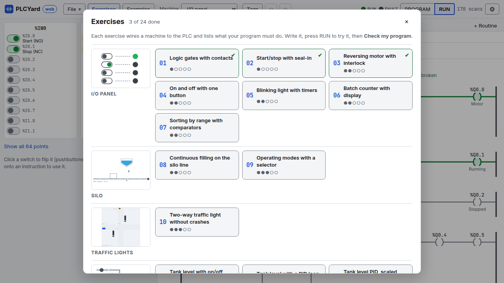
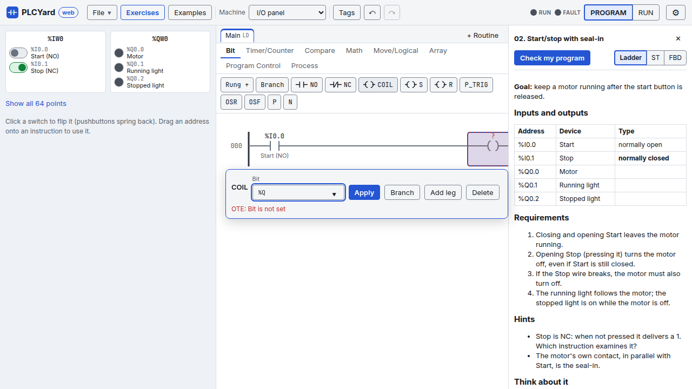

# PLCYard in the browser

**[Open PLCYard web](https://juliordz.com/plcyard/app/)**: the same PLC, simulations and exercise
checker as the desktop app, running in your browser. Nothing is installed and nothing is sent
anywhere: the PLC runs on your computer (the first visit downloads it, a few megabytes; later
visits start from the browser's cache).

## The screen

- **Header**, left to right:
    - **File**: a new program in ladder, structured text or function blocks, open or save a `.plcy`
      file (the desktop app opens it too), and the examples.
    - **Exercises** and **Examples**: the pickers below.
    - **Machine**: the simulation wired to the PLC.
    - **Tags** (named memory), undo and redo.
    - The **PLC**: the RUN and FAULT lights, and **PROGRAM / RUN**. RUN sends your program to the
      PLC and starts it. If you edit while it runs, **Send changes** appears: the PLC keeps running
      the old program until you press it.
    - **⚙**: the notation (IEC symbols `%I0.0` or mnemonics, see [Notations](notations.md)), the
      welcome tour again and a link to this wiki.
- **Left**: the machine. Buttons are held while you press them, switches stay where you put them.
  Below it, the list of its devices with their addresses; the I/O panel shows only the points your
  program or the exercise uses (**Show all 64 points** for the rest).
- **Middle**: the editor, with a tab per routine (**+ Routine** adds one, see
  [Routines and blocks](routines.md)).
- **Right**: the exercise, when one is open.

The first visit shows a short welcome; **⚙ → How it works** shows it again.

## Exercises and examples

**Exercises** opens the 24 exercises grouped by machine, each group with a picture of its machine,
each exercise with its level (●○○○○ easy to ●●●●● hard) and a ✔ once you passed it (kept in your
browser). Opening one wires its machine, names its devices and gives you an empty program.

**Examples** opens the finished programs, also grouped by machine with the language they are written
in. Opening an example replaces the program in the editor: save yours first (File → Save) if you
want to keep it.

## Writing a program

- **Ladder**: pick an instruction family (Bit, Timer/Counter, Compare…) and click an instruction:
  it goes after the selected one, or in a new rung. **Rung +** adds a rung, **Branch** puts the
  selected instruction in a parallel branch.
- The **operand form** opens right next to what you selected. Type an address or a tag: the list
  suggests the machine's devices by name ("Start (NO)"), the named I/O points and your tags. Enter
  applies, Esc closes. You can also **drag an address** from the machine onto an instruction.
- An instruction with a problem (no address yet, a tag that does not exist, the wrong type) has a
  **red dashed box**; point at it to read why. The program only goes to the PLC once every problem
  is fixed.
- **Structured text**: a code editor with colours, line numbers, problems as you type and a watch
  list of the values while the PLC runs.
- **Function blocks**: click a block or drag it onto the diagram, drag from an output pin to an
  input pin to wire them, select a block to set its operands. See
  [Function block diagram](fbd.md).

## Running and checking

1. Press **RUN**. The energized parts of the ladder turn green, the machine moves.
2. Play with the machine: press its buttons, open its valves, park a car…
3. With an exercise open, **Check my program** (top of the exercise) runs every requirement
   against your program on a fresh machine, much faster than real time, and lists what passed and
   what failed with the reason. Long exercises can take a few seconds.

**Ladder / ST / FBD** next to the Check button starts the exercise again in another language.

## What stays in the desktop app

Data types, forcing, the PID setup dialog, single-scan stepping and comparing your solution with
the reference solutions in three languages. A `.plcy` saved in the browser opens in the desktop
app and the other way round.
